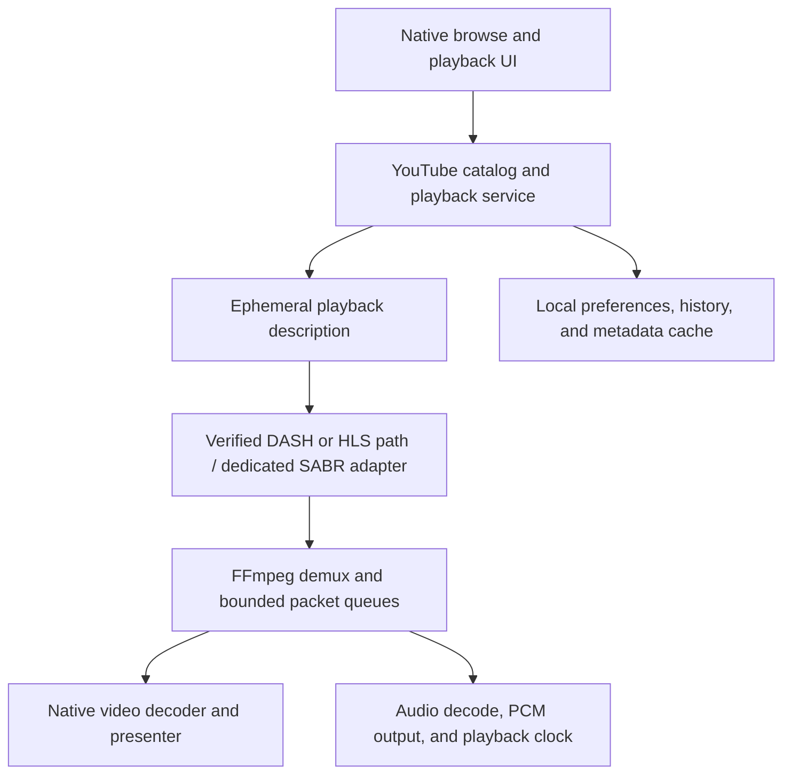

# ProsperoTube implementation plan

- Date: 2026-10-08 (America/New_York)
- Status: full PS5 SmartTube parity is the active objective; implementation and console/live-service acceptance remain incomplete. See [current goal](GOAL.md).
- Implementation: see [README](README.md), [decisions](docs/DECISIONS.md) and [acceptance](docs/HARDWARE_ACCEPTANCE.md). The milestone descriptions below preserve the original proposal; the first version uses a required LAN companion.
- Repository: private `blackbearreloaded/ProsperoTube`

## 1. Objective and current conclusion

Build a controller-first YouTube client for PS5 homebrew with 1:1 SmartTube
feature and behavior equivalence. The priorities below stage implementation;
they do not exclude account, advanced playback, integration or settings features
from the final objective. The existing prototype is an intermediate milestone.

A native implementation is technically plausible. Existing PS5 projects supply
video decoding, audio output, media demuxing, application packaging, and interface
components. Reproducing SmartTube's service and playback compatibility is the main
uncertainty. This is a substantial native reimplementation, with selected source
reuse where licensing and platform dependencies permit it.

The investigation inspected source, build files, and published hardware evidence.
It did not compile ProsperoTube, exercise current YouTube playback, or measure any
workload on a console. An enabled codec or demuxer is build evidence; a successful
controlled decoder test is hardware evidence; neither establishes complete product
playback. Keep these distinctions in every progress report.

### Intended scope

- Compatible PS5 homebrew environments; record each tested firmware and console.
- A native application with controller navigation and native playback.
- Standalone operation as the intended destination, conditional on Phase 2 results.
- An optional companion service to accelerate investigation or provide a fallback.
- Public, non-DRM video playback first. Account access and restricted-content
  behavior require separate validation; DRM integration is outside the initial scope.

Normal retail-console distribution and Android emulation are outside this native
homebrew implementation. Full SmartTube feature parity remains the active goal;
the staged prototype does not change that acceptance requirement.

## 2. Source baseline and evidence

Use these exact snapshots when reproducing the initial investigation. Commit dates
can differ from the planning date because of author timezone; the SHA is the identity.

| Project | Inspected revision | What it establishes |
| --- | --- | --- |
| [SmartTube](https://github.com/yuliskov/SmartTube/tree/2c60453007dfc3775ff525c3837c2d1d4e95aab9) | `2c60453007dfc3775ff525c3837c2d1d4e95aab9` | Android application, common controllers, modified ExoPlayer, DASH/HLS/SABR playback selection |
| [MediaServiceCore](https://github.com/yuliskov/MediaServiceCore/tree/4d9767733aa92269b9d24f24844a7fa1bb5196c1) | `4d9767733aa92269b9d24f24844a7fa1bb5196c1` | Exact service submodule pinned by the inspected SmartTube revision |
| SmartTube SharedModules | `13f5687dd6757b02fbcdf14c5403d0339e377db5` | Pinned dependency; its complete contents were not audited in this investigation |
| [ProsperoTV public main](https://github.com/blackbearreloaded/ProsperoTV/tree/fe60fba73fe326ee930f375182f5ac7404492698) | `fe60fba73fe326ee930f375182f5ac7404492698` | Native TV application, HTTP/media paths, hardware decoder/presenter, persisted catalog |
| [EVO Player](https://github.com/sainsaji/EVO-PLAYER-PS5/tree/9715f6ee9bf9b53461d6fdf9a2e11b4c48357783) | `9715f6ee9bf9b53461d6fdf9a2e11b4c48357783` | Provider interface, FFmpeg streaming build, native and software codec paths |
| [ps5-homebrew-ui pinned by EVO](https://github.com/blackbearreloaded/ps5-homebrew-ui/tree/4bd942579dd981b3df9c740438489ca6a614ddc0) | `4bd942579dd981b3df9c740438489ca6a614ddc0` | UI dependency identity; integration suitability still needs a targeted audit |

The local ProsperoTV development branch was ahead of public main. It was inspected
for context, but its unmerged features are not prerequisites or claimed capabilities
of this plan. Start reuse decisions from the public revision above.

### Findings that affect implementation

1. **SmartTube's common layer is still Android-dependent.** Its application and
   common modules depend on Android UI/lifecycle APIs and ExoPlayer. Moving the
   existing Java code behind a native interface does not remove these dependencies.
   See [application dependencies](https://github.com/yuliskov/SmartTube/blob/2c60453007dfc3775ff525c3837c2d1d4e95aab9/smarttubetv/build.gradle)
   and [common dependencies](https://github.com/yuliskov/SmartTube/blob/2c60453007dfc3775ff525c3837c2d1d4e95aab9/common/build.gradle).
2. **MediaServiceCore is not a platform-neutral drop-in library.** Its build uses
   Android, Retrofit/Gson, RxJava/RxAndroid, Cronet, and JavaScript-related
   dependencies. The active token-generator selector chooses an Android WebView
   implementation. See [service dependencies](https://github.com/yuliskov/MediaServiceCore/blob/4d9767733aa92269b9d24f24844a7fa1bb5196c1/youtubeapi/build.gradle)
   and [generator selection](https://github.com/yuliskov/MediaServiceCore/blob/4d9767733aa92269b9d24f24844a7fa1bb5196c1/youtubeapi/src/main/java/com/liskovsoft/youtubeapi/app/potokennp2/misc/PoTokenSelector.kt).
3. **SABR needs explicit consideration.** SmartTube selects DASH, SABR, live
   DASH/HLS, or URL formats according to the returned media information. Its custom
   SABR Java module contains approximately 8,634 lines in 65 files in this snapshot;
   the count includes its manifest and ExoPlayer integration code, not just the
   protocol parser. Standard DASH support does not implement this module.
   See [playback selection](https://github.com/yuliskov/SmartTube/blob/2c60453007dfc3775ff525c3837c2d1d4e95aab9/common/src/main/java/com/liskovsoft/smartyoutubetv2/common/app/models/playback/controllers/VideoLoaderController.java)
   and [SABR source](https://github.com/yuliskov/SmartTube/tree/2c60453007dfc3775ff525c3837c2d1d4e95aab9/exoplayer-amzn-2.10.6/library/sabr).
4. **EVO is the preferred first player experiment.** Its FFmpeg configuration
   enables DASH, HLS, libxml2, Opus, and the relevant media containers. Its provider
   API already separates browsing/search from resolving playback choices. These
   are useful seams, not proof that current YouTube media works unchanged.
   See [FFmpeg build](https://github.com/sainsaji/EVO-PLAYER-PS5/blob/9715f6ee9bf9b53461d6fdf9a2e11b4c48357783/scripts/build-ffmpeg.sh)
   and [provider API](https://github.com/sainsaji/EVO-PLAYER-PS5/blob/9715f6ee9bf9b53461d6fdf9a2e11b4c48357783/projects/evoplayer/addons/include/evo_provider.h).
5. **ProsperoTV needs media extensions for this workload.** Its public direct WebM
   parser skips non-video tracks. Its separate MP4/Matroska reader selects
   H.264/HEVC video and AAC/MP2/MP3/AC-3/E-AC-3 audio, not VP9/Opus. Its public
   player API accepts one source URL. Reusing its interface and decoder work is
   useful; complete adaptive YouTube playback is additional integration.
   See [WebM parser](https://github.com/blackbearreloaded/ProsperoTV/blob/fe60fba73fe326ee930f375182f5ac7404492698/src/iptv_webm.cpp),
   [media reader](https://github.com/blackbearreloaded/ProsperoTV/blob/fe60fba73fe326ee930f375182f5ac7404492698/src/iptv_media.cpp),
   and [player API](https://github.com/blackbearreloaded/ProsperoTV/blob/fe60fba73fe326ee930f375182f5ac7404492698/include/iptv_player.h).

## 3. Product scope and priorities

| Priority | Capability | Initial expectation |
| --- | --- | --- |
| P0 | Launch, controller navigation, text search, thumbnails, video details | Native PS5 screens with cancellation and useful error states |
| P0 | Anonymous public-video playback | 1080p SDR first, subject to format availability |
| P0 | Play/pause, seek, stop, volume, return to browser | Stable resource ownership and synchronized audio/video |
| P0 | Playback failures and network recovery | Bounded waits, retry controls, redacted diagnostics |
| P1 | Local history, resume, favorites, queue | Independent of Google account support |
| P1 | Captions and manual quality/audio selection | External caption timing and deliberate track selection |
| P1 | SponsorBlock | Optional categories, reliable seek, graceful API failure |
| P2 | Accounts, subscriptions, playlists, account history | Separate authentication and service-validation milestone |
| P2 | 4K VP9 SDR, live playback, higher frame rates | Capability-driven selection and console measurements |
| P3 | VP9 Profile 2 HDR, AV1 software decode, advanced playback speeds | Separate performance and output-validation work |
| P3 | Phone pairing, casting, voice search, live chat, PiP/background behavior | Individually scoped after the core client is dependable |

Local favorites are not YouTube playlists; local resume is not server watch-history
synchronization. Label these behaviors accurately in the UI.

Do not assume every video supplies AVC/AAC, DASH, HLS, or a progressive URL. The
client must advertise only verified combinations and explain unsupported ones.

## 4. Architecture and reuse strategy

### Initial decision

Prototype at EVO's existing provider/player boundary before choosing how much of
its application becomes ProsperoTube. Add only the capability needed to answer
the playback question. Borrow ProsperoTV's TV navigation patterns and the existing
UI kit where they fit. Do not merge both applications or ship unrelated EVO
features merely because they exist upstream.

After a successful player experiment, select one maintained application foundation:

- Retain an EVO-derived application if its provider seam and lifecycle make this
  the smallest reliable change.
- Use a focused shell based on the native app boilerplate/UI kit if trimming EVO
  creates more integration risk than keeping a small player boundary.
- Use a ProsperoTV-derived player only if measured results justify adding the
  required adaptive-media and audio support.

Record the decision and upstream commit before importing code. Avoid a JVM,
Android compatibility layer, full browser engine, or new general plugin framework
unless the feasibility spike establishes a concrete need.

### Proposed native data flow

The slash represents transport alternatives, not a claim that a SABR adapter
already exists. Native transport work must reuse the player's tested queues and
decoder lifecycle rather than replacing them at the same time.

### Minimal service boundary

Implement a small YouTube-specific service with operations for search, browse,
continuation, video metadata, playback resolution, and cancellation. Match existing
provider functions where possible. Add account operations only when implementing
account features; there is no need for a multi-service abstraction initially.

Keep these records separate:

| Record | Required information and lifetime |
| --- | --- |
| Catalog item | Stable video/channel ID, title, author, thumbnail, duration, live state; may be cached |
| Page | Items plus an opaque continuation cursor; preserve order and deduplicate by stable ID |
| Playback description | Transport, candidate tracks/manifest, required headers and their scope, expiry/re-resolution context, duration/live state, captions; short-lived |
| Local progress | Stable video ID, position, duration, completion state, update time; persisted atomically |
| Account session | Explicitly separate from playback URLs and anonymous state; storage design remains a Phase 4 decision |

EVO's stream choice already carries a URL, headers, container, codec hints,
dimensions, and a live flag. A usable manifest can fit that existing boundary.
An in-memory manifest, paired raw URLs, or session-aware SABR object may need a
small extension. Choose that extension only after seeing the actual missing case.

### Optional companion path

A user-controlled LAN service could perform catalog/playback resolution and, where
necessary, relay or repackage media into the manifest/container the PS5 player
understands. Prefer remuxing over transcoding when codec compatibility permits it.

Returning a remote URL alone may fail because headers, sessions, expiry, or network
context differ between resolver and player. Test direct consumption and relaying
separately. A server does not remove the need to maintain protocol compatibility.

This path changes deployment, availability, and account-storage requirements. It
is an optional experiment/fallback, not an assumed requirement for the product.
Implement a small versioned response shape only if a companion is actually chosen;
do not build a public cloud service or multi-user backend for the first prototype.

## 5. Phased implementation

### Phase 0 — Reproducible foundation and decisions

**Tasks**

- Confirm the target firmware, base/Pro console model, display, audio route, and
  available hardware test environment. Published evidence includes firmware 6.02
  and 12.70; this does not establish support for every firmware or access to both.
- Build the pinned EVO baseline in WSL using its existing documented toolchain.
  Record toolchain, FFmpeg configuration, linked dependencies, and output identity.
- Verify a known compatible local media fixture before changing the player.
- Audit licenses and provenance before copying service or player code (Section 9).
- Select a collision-free title identity and independent writable-data directory.
  Do not inherit another application's title ID or overwrite its installation/data.
- Keep credentials, build outputs, media fixtures without redistribution rights,
  captured sessions, and expiring URLs out of Git. Add ignore rules when these
  files first become part of development.

**Deliverable:** reproducible baseline instructions, a dependency/provenance list,
and a target-platform matrix. No feasibility claim is upgraded without a recorded test.

**Exit gate:** a clean baseline build and ordinary playback succeed on the target
console; code-reuse terms and application identity are resolved for the next step.

### Phase 1 — Adaptive playback spike

**Tasks**

- Create small, redistributable or locally generated fixtures: muxed AVC/AAC MP4,
  static DASH with separate AVC/AAC tracks, static DASH with VP9/Opus, and HLS.
- Feed standard manifests through EVO's existing stream/provider entry point.
  Confirm the actual console binary contains the needed demuxers and decoders.
- Validate manifest/segment redirects, byte ranges, fragmented initialization
  data, track headers, source cancellation, and clean end-of-stream behavior.
- Verify that headers reach the necessary nested requests while credentials stay
  scoped to the intended origin. Do not log authenticated URLs or header values.
- Measure clock drift, first-frame delay, seek behavior, queue levels, native
  decoder selection, and resource use. Preserve player behavior unless a specific
  fixture demonstrates a defect.
- Test external captions through the existing subtitle path where possible.

**Deliverable:** a minimal player/provider change, fixture-generation instructions,
and a result table with exact codec/profile/container/transport combinations.

**Exit gate:** separate audio/video playback passes the core acceptance matrix in
Section 7. A manifest that parses but produces silent video does not pass.

**Decision:** if standard DASH works, use it for eligible media. If a manifest
cannot express required session behavior, record the missing behavior before
introducing a transport adapter or paired-stream API.

### Phase 2 — Current YouTube service and transport feasibility

**Tasks**

- Trace SmartTube's search, metadata, format-information, caption, and playback
  selection flows at the pinned service revision. Produce a dependency map that
  identifies Android APIs, WebView, JavaScript runtimes, and shared-module helpers.
- Separate stable catalog parsing from the changing playback/session logic.
  Port or adapt only the subset needed for public anonymous videos initially.
- Verify real format availability across a fixed representative public-video
  sample. Record available transports and codecs rather than assuming a URL fallback.
- Assess JavaScript/WebView runtime portability as an independent experiment.
  A lightweight JS engine is not assumed to substitute for browser functionality;
  adding V8, QuickJS, or a web runtime needs demonstrated compatibility and cost.
- Compare the effort of native service adaptation with a maintained host-side
  resolver or companion. Audit any selected dependency and license first.
- Determine when current media requires SABR. Evaluate whether a reusable,
  maintained implementation can supply the needed transport semantics. If a native
  adapter is required, scope its parsing, request state, stream framing, seek,
  refresh, cancellation, and captions separately from the decoder.
- Exercise stream/session expiry and format-information refresh. Catalog entries
  retain video IDs; they must not retain an old playback URL as durable identity.
- Run the representative sample more than once on different days so a single
  successful session is not mistaken for a dependable service integration.

**Deliverable:** a playable end-to-end public-video experiment, a runtime dependency
assessment, and a written native-versus-companion decision with evidence.

**Exit gate:** anonymous playback succeeds across the agreed sample and recovers
from expiry/failure without restarting the application. Unsupported cases are
classified and visible. Do not promise standalone operation if it still requires
an unported browser/runtime dependency.

**Stop or rescope condition:** if reliable current playback requires a runtime or
transport project larger than the available budget, retain the player result and
choose a companion-based scope or pause the standalone milestone. A decoder demo
alone is not sufficient justification for a full client build.

### Phase 3 — Anonymous native MVP

**Tasks**

- Create a focused ProsperoTube identity and screen flow: home/search, results,
  video details, playback, local history, and settings.
- Use native text input and DualSense navigation. Preserve focus, scroll position,
  query, and selected result when returning from playback.
- Implement paged search and channel browsing with stable IDs, cancellation,
  bounded response sizes, and explicit loading/empty/offline/error states.
- Fetch thumbnails asynchronously with a bounded memory/disk cache. Handle
  missing images, long titles, Unicode, and image formats the UI can decode.
- Connect video selection to ephemeral playback resolution; keep all network and
  image decoding work off the UI frame loop.
- Start with a deliberately selected verified quality/codec combination. Expose
  manual quality choices only when the corresponding track switch works.
- Add captions, local resume/history/favorites, queue/next behavior, and simple
  settings using the selected foundation's existing storage facilities.
- Keep UI/controller and video presentation ownership consistent with the chosen
  player. Test overlays, app-close, background/foreground, and repeated sessions.

**Deliverable:** an installable private MVP with build instructions, supported
combinations, known limitations, and a hardware acceptance record.

**Exit gate:** a user can search, choose, watch, pause, seek, use captions, stop,
resume later, and return to the same result screen without leaked resources or
unbounded waits. Anonymous failure does not force account sign-in.

### Phase 4 — SponsorBlock and accounts

**SponsorBlock tasks**

- Query the maintained API for optional configured segment categories; keep the
  feature disabled/configurable until its behavior passes validation.
- Bind segment times to the player's media clock. Handle overlap, multiple
  categories, missing results, manual rewind, and completion without seek loops.
- Reuse existing seeking. API timeout or failure must not stop video playback.
- Consider the API's documented privacy-preserving query method and cache policy.
  Segment submission is a later feature, not a requirement for skipping.

**Account tasks**

- Validate the supported interactive authorization flow on the chosen service
  implementation; do not assume existing client credentials can be redistributed.
- Prefer an approval/code flow that avoids entering Google passwords on console.
  Implement poll cancellation, denial, expiration, and visible signed-in state.
- Determine available protected credential storage in the actual homebrew
  environment. Do not claim OS-backed encryption exists without verifying it.
- Implement sign-out, session refresh/revocation handling, account switching if
  needed, and removal of stored session material. Redact diagnostics by default.
- Add subscriptions and playlists before server history mutations. Keep local
  history behavior usable when account operations fail.
- Validate authenticated requests separately from anonymous transport; account
  authorization is not assumed to solve stream availability or playback challenges.

**Deliverable:** independently tested SponsorBlock and account capabilities, with
explicitly documented supported account operations and storage limitations.

**Exit gate:** account failures leave the application usable, sign-out removes
persisted credentials, and optional SponsorBlock cannot break ordinary playback.

### Phase 5 — Higher quality and live playback

- Add 1440p/4K VP9 Profile 0 SDR using the same service, queues, and clocks.
- Match queue depth, compressed input size, native decoder limits, and presentation
  pacing to measured content. Measure playback through completed presentation,
  not just decoder submission or decode-only throughput.
- Add live/DVR behavior only after validating live manifests, refresh timing,
  moving windows, interruption, and return-to-live controls.
- Treat VP9 Profile 2 HDR as a separate decoder/color-output integration. Confirm
  bit depth, surface representation, transfer function, primaries, and display mode
  together; compare known SDR/HDR fixtures before using arbitrary online content.
- Add AV1 software decode only if representative workloads, memory use, seeking,
  and thermals/pacing pass. Prefer verified hardware-supported formats when offered.
- Add playback speed only with correct audio handling and synchronized timestamps.
  Phone pairing/casting, voice search, live chat, and system PiP each need their own
  investigation and acceptance criteria.

**Deliverable:** a measured capability matrix per console/firmware, with graceful
fallbacks for unsupported media. No general 4K60/HDR/AV1 guarantee follows from one clip.

### Phase 6 — Release and ongoing maintenance

- Reproduce builds from pinned dependencies and a clean environment; provide
  artifact checksums, source revision, dependency configuration, and license notices.
- Preserve settings/history across updates and support a safe rollback strategy
  for data-schema changes. Reuse proven packaging/update code where suitable.
- Keep diagnostic collection optional, bounded, and free of account tokens,
  cookies, personal search terms, and complete signed playback URLs.
- Maintain a small service regression sample and protocol/runtime compatibility
  notes. Isolate service fixes so they do not require player or UI rewrites.
- Recheck upstream licenses, behavior, and build configuration when updating pins.
- Document tested firmware rather than copying broad compatibility claims from
  another project's README.

The first private MVP does not need a custom updater, telemetry service, plugin
marketplace, cloud backend, or elaborate CI pipeline. Add release automation when
there is a working application and a repeatable build worth automating.

## 6. Challenges and unknowns register

All entries below are unresolved unless marked as source-established. Severity
expresses impact on the intended product, not a measured probability.

| ID | Question / challenge | Severity | Current evidence | Experiment or resolution | Consequence if unresolved |
| --- | --- | --- | --- | --- | --- |
| U01 | Can the service subset run without Android/WebView? | Critical | Active generator is WebView-based; API build is Android-dependent | Phase 2 dependency map and host/native runtime experiment | Standalone delivery may require a much larger runtime project |
| U02 | Which transports and codecs are available for current public videos? | Critical | SmartTube supports several alternatives; no live PS5 sample tested | Fixed diverse sample, repeated on different days | Cannot promise AVC/AAC or ordinary DASH fallback |
| U03 | Can required SABR behavior be reused or adapted within budget? | Critical | Custom ExoPlayer module is present; ordinary FFmpeg DASH does not replace it | Transport scope audit and a narrow end-to-end experiment | A companion or reduced playback scope may be necessary |
| U04 | Does the actual PS5 FFmpeg/player path handle separate tracks and nested requests correctly? | High | EVO build enables DASH/HLS and Opus; configuration evidence only | Generated fixtures plus manifest/header/range tests | Provider integration needs targeted player/I/O changes |
| U05 | Are credentials/headers propagated correctly without leaking across origins? | High | Existing URL/header interfaces are useful but insufficiently tested for this workload | Controlled redirect/segment fixture, redacted observation | Authentication failures or credential exposure |
| U06 | How should stream/session expiry be recovered while preserving playback position? | High | Service cache/refresh logic exists upstream; no PS5 implementation | Expiry during playback and seek/re-resolution tests | Long videos may stall or restart |
| U07 | Is service-library code reuse clearly licensed? | High | No top-level license found in inspected MediaServiceCore tree | Confirm upstream terms before copying; audit shared dependencies | Reuse strategy must change or await clarification |
| U08 | Which application foundation has the lowest lifecycle/integration cost? | Medium | EVO has broader media; ProsperoTV has a focused TV shell | Phase 1 prototype and small integration diff | Premature code extraction can consume the initial budget |
| U09 | What authenticated operations and credential storage are actually supportable? | High | Existing source has account support; PS5 storage guarantees unverified | Phase 4 auth/storage design and failure tests | Account features may remain limited or companion-dependent |
| U10 | Does 4K VP9 sustain completed playback with audio and online ingestion? | High | Controlled hardware/presentation evidence exists; product workload untested | Paced 4K sample with queue/drop/clock metrics | Limit advertised quality or adjust pipeline |
| U11 | How much VP9 Profile 2 HDR integration is needed? | High | Research demonstrates 4K capability; EVO profile-2 descriptor remains limited in this snapshot | Known 10-bit fixtures, decoder config, color/display validation | HDR remains deferred even if 4K SDR succeeds |
| U12 | Is AV1 software decoding worthwhile on the target console/content? | Medium | EVO uses libdav1d and reports working cases | Representative bitrate/frame-rate/seek/memory tests | Prefer AVC/VP9; omit AV1 from advertised support |
| U13 | Can captions, alternate audio, and SponsorBlock preserve timing through seeks? | Medium | Upstream implementations provide behavioral references | Timing fixtures, discontinuities, repeated seek/rewind tests | Feature-specific exclusions or additional clock work |
| U14 | Can a companion return direct URLs, or must it relay/repackage media? | High if chosen | Session/network-context behavior is untested | Compare direct consumption with bounded relay under the same sample | Different server bandwidth and deployment requirements |
| U15 | Which firmware/console models are actually supported? | High | Published evidence is bounded to particular environments | Record and test available targets; expand only with evidence | Narrow initial compatibility statement |
| U16 | Can the UI retain responsiveness during fetches, thumbnail work, and playback transitions? | Medium | Existing UI kits and applications supply reusable patterns | Long lists, slow network, Unicode, rapid navigation, teardown loop | Need targeted scheduling/cache/ownership fixes |

### Important capability distinctions

- HEVC support is useful player capability but does not establish HEVC availability
  for the YouTube videos this client will encounter.
- VP9 decoding at 4K does not establish correct audio, seeking, network ingestion,
  or every possible profile/frame structure in a product session.
- Enabling AV1 software decode does not establish real-time 4K60 performance.
- Completing an HDR-target flip does not alone establish calibrated HDR output.
- Service metadata success does not establish playable media access.
- A WebView-dependent task is not automatically solved by a standalone JS engine.

## 7. Validation and proposed acceptance criteria

These are initial engineering targets, not measured current performance. Adjust
them explicitly when a controlled baseline demonstrates a better justified target.
Document fixtures, source revision, console/firmware, display mode, and measurement
boundary so later comparisons remain meaningful.

### Host checks

- Test the service/parser subset with sanitized captured or synthetic JSON: absent
  fields, malformed values, Unicode, continuation, live/unavailable media, and errors.
- Verify playback-description mapping for DASH/HLS/SABR/URL cases without assuming
  all formats exist. Preserve stable IDs across resolution and refresh.
- Check cancellation, expiry handling, bounded parsing, and URL/header scoping at
  the component boundary. Include one focused regression per real defect.
- Use generated media fixtures and the existing project test harness where it
  applies. Avoid tests that merely repeat UI markup or hard-code implementation details.
- Validate storage upgrades and atomic progress writes before changing schemas.

### Console matrix

| Area | Initial acceptance target | Evidence to keep |
| --- | --- | --- |
| Baseline playback | Muxed AVC/AAC and separate-track DASH play with both picture and sound | Codec/profile/container, decoder, resolution, output mode |
| Clock stability | Thirty-minute controlled playback without cumulative drift; measured A/V offset generally within 100 ms | Audio/video timestamps and an identifiable sync fixture |
| Seek and pause | Twenty forward/backward seeks and pause/resume operations without deadlock; streams re-align | Seek request/completion, queues, clock-reset behavior |
| Teardown | Fifty open/play/stop cycles without monotonic memory/resource growth or failures | Before/after memory, handles/queues where observable, decoder cleanup |
| Cancellation | Cancel slow fetch/open promptly, initially targeting return of control within two seconds | Timeout/interrupt behavior and UI responsiveness |
| Network interruption | Brief interruption and controlled request failure produce recovery or an actionable retry | Bounded retry count, error classification, resumed position |
| Expiry | Expired playback information is refreshed without exposing credentials or duplicating sessions | Refresh result and restoration of playback state |
| Browsing | Controller and text input remain responsive during slow requests and thumbnail fetches | Focus/scroll restoration and observation of UI stalls |
| Captions | Known cues stay aligned before/after pause and seek, including Unicode and missing-caption cases | Cue timestamps and displayed outcomes |
| 1080p60 / later 4K | Stable audio and paced completed presentation over the agreed sample; drops classified | Presented/dropped frames, queue underruns, memory, first-frame delay |
| Account behavior | Denial/expiry/sign-out work; no secret values appear in captured diagnostics | Sanitized state transitions and storage deletion result |
| SponsorBlock | Correct category handling and skips without loops; API failure does not interrupt playback | Segment-to-clock decisions and seek completion |

Live/public-service tests should use an agreed sample covering short/long videos,
different codecs/frame rates, captions, alternate audio where offered, unavailable
videos, and later live/DVR. Keep video IDs and expected outcomes where appropriate;
keep secrets and ephemeral media URLs out of the repository. Account-only tests
require a separately designated test account and must not silently use a developer's
primary account.

## 8. Effort, sequencing, and project resources

These ranges are planning estimates for one experienced developer, assuming an
available test console and a reusable player/toolchain. They are not additive
commitments. Phases overlap and may be stopped or rescoped at their exit gates.

| Outcome | Indicative elapsed effort | Main dependency |
| --- | --- | --- |
| Reproducible player/adaptive-media spike | 1–3 weeks | Working toolchain, fixtures, actual console access |
| Basic native client with companion service | 4–8 weeks | Maintained host-side service/transport path that passes Phase 2 |
| Usable standalone native client | 3–6+ months | Service runtime and required transport portability established |
| Broad SmartTube feature set | 6–12+ months and continuing maintenance | Accounts, live media, quality/HDR, remote features, service churn |

If Phase 2 requires a browser runtime port or a large new SABR implementation,
re-estimate rather than compressing that work into the standalone range.

### Practical resources

- WSL with Git/GitHub CLI and the chosen upstream's documented native build tools.
- A target PS5 homebrew console, repeatable application launch, and a way to collect
  redacted application diagnostics. This plan does not include exploit development.
- A host capable of generating fixtures and serving controlled HTTP(S) media.
- Display/audio equipment appropriate to the claimed SDR/HDR and frame-rate modes.
- Time for source/license auditing, graphics/audio integration, and service upkeep.
- Optional PC/NAS capacity only if the companion experiment is selected.

The first deliverable should settle the player/service risks before expensive UI
polish. After that, work in small vertical slices: search-to-play, then seek/resume,
then captions, rather than building a complete catalog UI around an unproven player.

## 9. Licensing and distribution decisions

SmartTube's root license at the inspected revision is MIT. ProsperoTV and EVO
declare GPL-3.0-or-later. Embedded libraries and separate repositories have their
own terms. The inspected MediaServiceCore tree contains no top-level LICENSE;
the SmartTube root license must not be assumed to cover that independent repository.

Before importing code:

1. Establish the terms for each copied component, including MediaServiceCore,
   SharedModules, modified ExoPlayer/SABR code, UI code, and generated shader assets.
2. Preserve source copyright/license notices and record the upstream commit and
   modifications. Keep a third-party notice file when code is actually imported.
3. Plan a GPL-compatible application release if using GPL player/application code;
   settle the project's own license at the implementation milestone.
4. Record the actual FFmpeg configure flags and linked-library licenses. A generic
   FFmpeg label does not establish the terms of a particular binary.
5. Use independent branding and application identity. Do not redistribute upstream
   credentials, captured account data, proprietary firmware/SDK files, or artwork
   whose reuse terms have not been established.

Private visibility does not replace provenance tracking or determine the eventual
distribution terms. Clarification may require contacting a dependency maintainer;
no such contact has been made as part of this plan.

Sources: [SmartTube MIT license](https://github.com/yuliskov/SmartTube/blob/2c60453007dfc3775ff525c3837c2d1d4e95aab9/LICENSE),
[ProsperoTV license](https://github.com/blackbearreloaded/ProsperoTV/blob/fe60fba73fe326ee930f375182f5ac7404492698/LICENSE),
and [EVO licensing/provenance](https://github.com/sainsaji/EVO-PLAYER-PS5/blob/9715f6ee9bf9b53461d6fdf9a2e11b4c48357783/COPYRIGHT.md).

## 10. Reference resources and reading order

### Start here

1. [EVO provider interface](https://github.com/sainsaji/EVO-PLAYER-PS5/blob/9715f6ee9bf9b53461d6fdf9a2e11b4c48357783/projects/evoplayer/addons/include/evo_provider.h)
   — catalog/search/resolve hooks and the existing playback-choice shape.
2. [EVO streaming I/O](https://github.com/sainsaji/EVO-PLAYER-PS5/blob/9715f6ee9bf9b53461d6fdf9a2e11b4c48357783/projects/evoplayer/media/src/evo_stream_io.c)
   and [demux thread](https://github.com/sainsaji/EVO-PLAYER-PS5/blob/9715f6ee9bf9b53461d6fdf9a2e11b4c48357783/projects/evoplayer/media/src/evo_demux.c)
   — opening, cancellation, queues, and seek ownership.
3. [EVO FFmpeg build](https://github.com/sainsaji/EVO-PLAYER-PS5/blob/9715f6ee9bf9b53461d6fdf9a2e11b4c48357783/scripts/build-ffmpeg.sh)
   — exact decoder/demuxer dependencies, including DASH/libxml2 and Opus.
4. [SmartTube VideoLoaderController](https://github.com/yuliskov/SmartTube/blob/2c60453007dfc3775ff525c3837c2d1d4e95aab9/common/src/main/java/com/liskovsoft/smartyoutubetv2/common/app/models/playback/controllers/VideoLoaderController.java)
   and [ExoMediaSourceFactory](https://github.com/yuliskov/SmartTube/blob/2c60453007dfc3775ff525c3837c2d1d4e95aab9/common/src/main/java/com/liskovsoft/smartyoutubetv2/common/exoplayer/ExoMediaSourceFactory.java)
   — actual transport selection and playback integration.
5. [MediaItemFormatInfo](https://github.com/yuliskov/MediaServiceCore/blob/4d9767733aa92269b9d24f24844a7fa1bb5196c1/mediaserviceinterfaces/src/main/java/com/liskovsoft/mediaserviceinterfaces/data/MediaItemFormatInfo.java)
   and [FormatInfoWrapper](https://github.com/yuliskov/MediaServiceCore/blob/4d9767733aa92269b9d24f24844a7fa1bb5196c1/youtubeapi/src/main/java/com/liskovsoft/youtubeapi/service/internal/FormatInfoWrapper.kt)
   — metadata/playback boundary and cache/refresh behavior.
6. [WebView runtime dependency](https://github.com/yuliskov/MediaServiceCore/blob/4d9767733aa92269b9d24f24844a7fa1bb5196c1/youtubeapi/src/main/java/com/liskovsoft/youtubeapi/app/potokennp2/generators/PoTokenWebView4.kt)
   and [custom SABR module](https://github.com/yuliskov/SmartTube/tree/2c60453007dfc3775ff525c3837c2d1d4e95aab9/exoplayer-amzn-2.10.6/library/sabr)
   — the two largest standalone-porting uncertainties.

### Platform and interface references

- [ProsperoTV](https://github.com/blackbearreloaded/ProsperoTV/tree/fe60fba73fe326ee930f375182f5ac7404492698)
  — TV application structure, controller flow, persistence, native media paths.
- [PS5 native app boilerplate](https://github.com/blackbearreloaded/ps5-native-app-boilerplate)
  — native build/application packaging reference; pin a revision if adopted.
- [ps5-homebrew-ui](https://github.com/blackbearreloaded/ps5-homebrew-ui/tree/4bd942579dd981b3df9c740438489ca6a614ddc0)
  — existing native TV interface components.
- [PS5 hardware video decoding research](https://github.com/blackbearreloaded/ps5-hardware-video-decoding-research)
  — controlled decoder/presentation evidence and measurement boundaries. Its
  reported capability is not ProsperoTube's supported-product matrix.
- [EVO native video decoder](https://github.com/sainsaji/EVO-PLAYER-PS5/blob/9715f6ee9bf9b53461d6fdf9a2e11b4c48357783/projects/evoplayer/media/src/evo_vdec_native.c)
  — actual profile/level choices and packet handling; compare this with research
  before assuming Profile 2 at 4K is enabled in the player.

### Protocol and feature documentation

- [FFmpeg format/demuxer documentation](https://ffmpeg.org/ffmpeg-formats.html#dash)
  — standard DASH/HLS behavior; consult the pinned library version as well.
- [SponsorBlock API documentation](https://wiki.sponsor.ajay.app/w/API_Docs)
  — segment-query semantics and documented privacy options.
- [YouTube Data API video resource](https://developers.google.com/youtube/v3/docs/videos)
  — metadata API boundary. It is not the native media-stream interface this player needs.
- [YouTube embedded player API](https://developers.google.com/youtube/iframe_api_reference)
  — official embedded playback model; a web-player integration is a different
  architecture from reusing the native PS5 player.

Mutable reference links supplement the pinned source baseline. Verify and pin
newly adopted dependencies at the time of implementation.

## 11. Immediate backlog

- [ ] Confirm available console/firmware/display and reproducible test procedure.
- [ ] Resolve reuse terms for the specific service/player subset before importing it.
- [ ] Build and record the pinned EVO baseline in WSL.
- [ ] Generate AVC/AAC and VP9/Opus adaptive fixtures with known timing.
- [ ] Prove separate-track DASH with audio, seeking, and teardown on PS5.
- [ ] Map the service subset's Android/WebView/JS dependencies.
- [ ] Validate current public-video formats and transport requirements.
- [ ] Record the standalone-versus-companion feasibility decision.
- [ ] Choose one application foundation and a unique title/data identity.
- [ ] Implement the search-to-play vertical slice, then resume and captions.

No checkbox above is complete merely because this plan or its source references
exist. The next implementation milestone is the adaptive playback spike, followed
by current-service feasibility before building the full interface.
