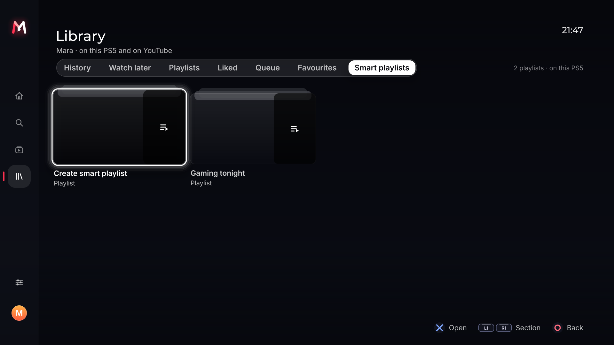
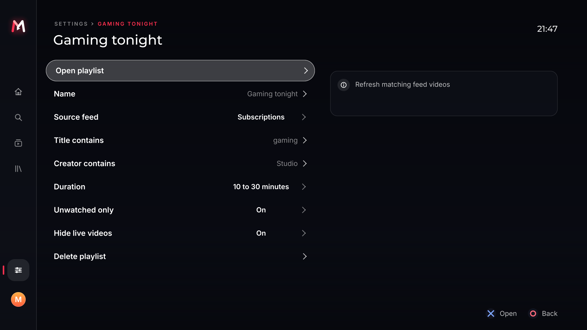

<p align="center">
  
</p>

<h1 align="center">YouTube Max’d</h1>

<p align="center">
  <strong>YouTube on your PS5, with local voice search, Smart playlists and Auto Max quality.</strong><br>
  A standalone homebrew client with selectable video formats and matching red-to-white DualSense effects.
</p>

<p align="center">
  <a href="https://github.com/HandshakeHackin/youtube-maxd/releases/download/v1.2.0-preview.1/PPSA99991.zip"><strong>Download the PS5 app</strong></a>
  · <a href="https://github.com/HandshakeHackin/youtube-maxd/releases/tag/v1.2.0-preview.1">Preview release</a>
  · <a href="docs/BUILD.md">Build guide</a>
  · <a href="LICENSE">GPL-3.0-or-later</a>
</p>

**Built on [ProsperoTube](https://github.com/LedyBacer/ProsperoTube), originally developed by BlackBearReloaded, and [EVO Player](https://github.com/sainsaji/EVO-PLAYER-PS5).** Their YouTube service, interfaces, account integration and native media player form this app’s foundation. Thank you to their developers and contributors. See [credits and licenses](#credits-and-licenses) for attribution and source provenance.

| Current build | Details |
| --- | --- |
| App / release | **1.2.0** / `v1.2.0-preview.1` |
| Intended setup | Jailbroken PS5, firmware **11.00**, **ShadowMount+** |
| Runtime | Search, extraction, playback and voice recognition run on the PS5 |
| Companion / Google Cloud | No PC/NAS companion, API key or Google Cloud project required |
| Launcher / data | `PPSA99991` · `/data/youtube-maxd` |
| Status | Experimental preview; this exact integrated build has **not been tested on a PS5** |

The app is built and has passed host-side checks. Hardware boot, real YouTube sign-in/playback, microphone routing, controller lighting and performance still need console testing. [Validation details](docs/MAXD_VALIDATION.md) distinguish these checks from inherited upstream results.

## On this page

[Download](#download) · [Features](#features) · [Video formats](#video-formats-and-quality) · [Previews](#interface-previews) · [Install](#install-on-ps5) · [Sign-in](#google-sign-in-and-accounts) · [Controls](#controls-and-light-bar) · [Testing](#testing-and-current-limits) · [Build](#build-from-source) · [Documentation](#documentation) · [Contributing](#contributing-and-bug-reports) · [Credits](#credits-and-licenses)

## Download

**[Download PPSA99991.zip — about 95 MB](https://github.com/HandshakeHackin/youtube-maxd/releases/download/v1.2.0-preview.1/PPSA99991.zip)**

This is the application bundle to extract for ShadowMount+. It includes the executable, assets, helpers and local voice model.

| Item | Link |
| --- | --- |
| Alternate app ZIP file page | [YouTube-Maxd-PS5.zip](https://github.com/HandshakeHackin/youtube-maxd/blob/downloads/YouTube-Maxd-PS5.zip) |
| Complete corresponding source | [YouTube-Maxd-source.zip](https://github.com/HandshakeHackin/youtube-maxd/releases/download/v1.2.0-preview.1/YouTube-Maxd-source.zip) |
| Release notes | [v1.2.0-preview.1](https://github.com/HandshakeHackin/youtube-maxd/releases/tag/v1.2.0-preview.1) |
| Launcher icon | [YouTube-Maxd-icon.png](https://github.com/HandshakeHackin/youtube-maxd/releases/download/v1.2.0-preview.1/YouTube-Maxd-icon.png) |
| Download checksums | [SHA256SUMS](https://github.com/HandshakeHackin/youtube-maxd/releases/download/v1.2.0-preview.1/SHA256SUMS) |
| Application source | [`main`](https://github.com/HandshakeHackin/youtube-maxd/tree/main) · [build instructions](#build-from-source) |

If clicking the app link opens a file page, use its **Download raw file** button. Downloads are public; no GitHub account is required. The icon is artwork; the app is the **ZIP**.

The release’s **Assets** section contains the app ZIP, complete source ZIP, icon, SHA-256 checksums, release notes, testing guide/results, validation JSON and catalog scan report. The `downloads` branch keeps the byte-identical `YouTube-Maxd-PS5.zip` as an alternate download. GitHub’s automatically generated **Source code** archives omit recursive submodules and cannot be installed as the app; use the recursive clone below to rebuild it. The initial app bundle corresponds to source commit [`014adc2`](https://github.com/HandshakeHackin/youtube-maxd/tree/014adc2d901518f47fb4d1fbc99eab15b41b79aa).

Automatic updates are disabled until a separate Max’d release feed is configured. Check this repository for new builds. ProsperoStore submission is open as [catalog PR #397](https://github.com/darkxex/ps5-homebrew-catalog/pull/397). Submission validation and the release scan passed; store availability awaits maintainer review, merge and deployment. See [submission details](store/SUBMISSION.md).

## Features

### Max’d additions

| Feature | What it does |
| --- | --- |
| **Local voice search** | Hold **L3**, speak after **Listening** appears, then release to search. A bundled multilingual Whisper tiny model recognizes speech on the console. Circle cancels; recording stops after six seconds. |
| **Smart playlists** | Create local rule-based collections from Home, Subscriptions, Favorites or Play queue. Combine title, creator, duration, unwatched and live-video filters. Each profile owns its collections. |
| **Auto Max quality** | Optionally lower quality after sustained buffering or dropped frames, then try an upgrade after stable playback. Saved resolution/FPS/codec limits and manual format choices take priority. Off by default. |
| **Saved maximum quality** | Store a per-profile resolution ceiling from **144p to 2160p**, alongside existing frame-rate and codec preferences. |
| **Red-to-white identity** | The approved faceted M/play icon, matching interface mark and animated DualSense effects use red, soft red and white. |
| **Separate app storage** | Max’d settings and accounts live under `/data/youtube-maxd`, with its own launcher/helper identity. |

Voice recognition needs no speech server or paid speech API. Microphone audio stays in console memory; recognized text goes to normal YouTube search. Actual PS5 recognition speed and microphone compatibility remain unverified. See [voice search](docs/VOICE_SEARCH.md).

Smart playlists refresh when opened and inspect up to eight feed pages, retaining up to 128 unique matches. They filter available feed results rather than scanning your entire account. They do not create or edit YouTube playlists. See [Smart playlists and Auto Max](docs/MAXD_FEATURES.md) for rules and limits.

Auto Max changes formats by reopening playback at the current position while retaining selected audio and captions. A brief interruption can occur. It is disabled during live playback and yields to manual selection; it does not guarantee smooth 4K.

### Browsing and your library

- Search with suggestions, history and filters; open video, playlist and channel links.
- Home, Discover and topic feeds, channels, related videos and playlists.
- Comments and replies, live chat and chat replay from the upstream implementation.
- Guest browsing, local history, resume, favorites, followed channels and an ordered queue.
- Signed-in subscriptions, Watch later, playlists, history and account-library integration.
- Local profiles, settings backup/restore and subscriptions import, including upstream NewPipe, PocketTube and GrayJay support.

### Playback and customization

- Per-video **video format and audio-track selection**, including returned alternate-language tracks.
- Captions, automatic captions, translation, two caption languages at once and caption styling.
- Chapters, storyboard seek previews, playback speed, sleep timer, aspect/zoom and audio delay.
- Live DVR/rewind and stream-recovery paths from ProsperoTube/EVO.
- Classic and Afterglow interfaces; Classic is the default.
- Afterglow, Onyx, Daybreak and High contrast themes, plus inherited interface translations. Some player controls remain English.
- Experimental phone casting and background audio inherited from ProsperoTube; both need console acceptance for this build.

### SponsorBlock, DeArrow and ads

- **SponsorBlock:** optional community segment skipping with category controls, skip review and Undo.
- **DeArrow:** optional community titles and thumbnails to reduce clickbait; originals remain available.
- **Return YouTube Dislike:** optional dislike-count integration, off by default.

Direct media playback does not request separate ad placements. SponsorBlock skips community-marked segments within videos. Availability depends on YouTube and community metadata; the app does **not guarantee removal of every ad**, including server-inserted ads. SponsorBlock and DeArrow are credited community services, not Max’d inventions.

## Video formats and quality

The saved maximum-quality choices are:

| Resolution | Common name |
| --- | --- |
| 144p / 240p / 360p / 480p | Lower-bandwidth / SD choices |
| 720p | HD |
| 1080p | Full HD |
| 1440p | QHD |
| 2160p | 4K UHD |

| Video codec | Included decoding path |
| --- | --- |
| AVC / H.264 | Native PS5 decoder through EVO/ProsperoTube |
| VP9 | Native PS5 decoder through EVO/ProsperoTube |
| HEVC / H.265 | Native PS5 decoder through EVO/ProsperoTube |
| AV1 | Software decoding with dav1d |

Choose a format in playback options with **R2**, or set **YouTube preferences → Maximum quality** for future playback. Frame-rate and codec preferences constrain automatic choices. Available options depend on the video, YouTube’s returned streams and the decoder path; selecting a ceiling does not create a missing format.

The inherited player includes HDR and display/frame-rate handling. **4K, HDR, 60 fps and AV1 throughput have not been validated for this Max’d build on firmware 11.00.** Software AV1 can be demanding. Rotation/mirroring controls are omitted from the default build; normal aspect and zoom controls remain included.

## Interface previews





*These are PC-rendered test-harness previews of Max’d’s Afterglow interface with invented account/video data. They are not PS5 captures or evidence of live YouTube playback. Afterglow is selectable in Interface preferences.*

## Install on PS5

You need a jailbroken PS5 with your compatible homebrew environment already configured. The intended setup is **firmware 11.00 with ShadowMount+**; this repository does not install a jailbreak.

1. Download **[PPSA99991.zip](https://github.com/HandshakeHackin/youtube-maxd/releases/download/v1.2.0-preview.1/PPSA99991.zip)**.
2. Close any previous Max’d instance. Back up its app folder and `/data/youtube-maxd` settings if you want rollback.
3. Extract the ZIP. Copy the complete **`PPSA99991`** folder to a location scanned by ShadowMount+, commonly **`/data/homebrew/PPSA99991`**.
4. Use your configured native homebrew startup environment. Startup requires the console-side ELF loader on **TCP 9021** or a compatible resident **Lapy** service. The packaged helper and manifest are bound to `PPSA99991`.
5. Launch **YouTube Max’d**, then browse as **Guest** or choose **Sign in to YouTube**.

Keep the entire folder, including runtime assets, helper files and `assets/voice/ggml-tiny.bin`. Copying only the executable or icon is insufficient. The development title ID `PPSA99991` and content version `01.002.000` are used; avoid overwriting another homebrew app with the same ID.

Settings and account files live in `/data/youtube-maxd`. Old prototype `/download0` settings and tokens are not automatically imported; sign in again through the current device-code flow.

## Google sign-in and accounts

**Neither the developer nor each user needs to create a Google Cloud project for this build.** The embedded YouTube.js service uses a TV device-code flow; no developer OAuth JSON, Data API key, copied browser cookies or companion service is required. There is no Google Cloud hosting bill from the app. YouTube’s service limits still apply.

1. Open **Sign in to YouTube** from the menu or Accounts.
2. The app displays an activation address, code and QR code.
3. Open the Google activation page on your phone/computer, select your account and approve access. Enter your password only on Google’s page.
4. The app adds the signed-in account as a profile alongside Guest.

Subscriptions and account-library integrations are included. Account changes such as liking, subscribing and playlist edits retain ProsperoTube’s explicit confirmation flow. Real account consent, refresh and account actions still need testing on the target console.

Tokens are stored locally at `/data/youtube-maxd/accounts/oauth-profiles.json` as plain text with restricted file permissions, without hardware-backed encryption. Keep these files out of shared backups and bug reports. Removing an account deletes the local profile; to revoke Google access as well, remove the relevant **YouTube on TV** connection from [Google account permissions](https://myaccount.google.com/permissions).

Private, age-restricted, members-only and paid/account-required playback is **off by default**. Signing in does not guarantee access to those videos. See [the sign-in guide](docs/GOOGLE_LOGIN.md).

## Controls and light bar

| Context | Control / location |
| --- | --- |
| Browse | D-pad to move; Cross to select; Circle to go back |
| Typed search | Square |
| Voice search in browser | Hold L3 until **Listening**, speak, release; Circle cancels |
| Player | Cross to pause/resume; Left/Right to seek; Circle to stop |
| Playback options | R2 for quality, audio track, speed and other options |
| Captions / chapters | Up/Down for captions; L1/R1 for chapters |
| Saved resolution ceiling | YouTube preferences → Maximum quality |
| Auto Max | YouTube preferences → Auto Max quality; off by default |
| Smart playlists | Main Smart playlists section; Afterglow Library → Smart playlists |
| Interface | Interface preferences → Classic / Afterglow |
| Controller effects | Player settings → controller feedback / light-bar switch |

Follow the on-screen button hints for context-specific shortcuts. Voice search starts after a 350 ms hold; a short L3 press retains its existing context action. Playback pauses before microphone capture.

The artwork and controller effects share **red `#FF304F`**, **soft red `#FFA5AA`** and **white `#FFFFFF`**:

| App state | DualSense effect |
| --- | --- |
| Browsing | Red-to-white cycle |
| Loading / signing in | Breathing effect |
| Voice search | Listening animation, then recognition/loading effect |
| Playing | Dim red |
| Paused | Dim white |
| Error | Soft red pulse |

The feedback switch disables the effects; exit/soft-close turns them off. Physical colors, reconnect and system-overlay behavior need PS5 testing. **These effects control the DualSense controller. Console chassis LED control is not implemented.**

## Testing and current limits

Completed checks include native compilation and executable/ZIP integrity, embedded-service/account fixtures, quality and profile persistence, SponsorBlock integration, real-model host speech recognition, Smart playlist/Auto Max policy and provider checks, controller-bridge checks, and Afterglow interface fixtures. Sanitizer runs cover native integration paths. Details are in [MAXD_VALIDATION.md](docs/MAXD_VALIDATION.md).

This exact integrated app still needs firmware 11.00 / ShadowMount+ acceptance for boot and clean exit, live search/playback, account consent, codecs/4K/HDR, microphone capture and speed, physical lighting, real Auto Max decisions, casting and background audio. Upstream’s console results apply to its tested revisions; they do not certify this fork.

YouTube can change internal APIs or refuse a client, which may require an update. This is an experimental preview rather than a completed console launch. The next milestone is hardware acceptance of these existing features, including playback continuity, account persistence, voice cancellation and controller cleanup.

## Build from source

Use **x86-64 Linux or WSL** and the prerequisites in [docs/BUILD.md](docs/BUILD.md). Keep WSL caches on the Linux filesystem; native media dependencies need several GiB of RAM and disk space. Build inputs are pinned, and no console is contacted by the build.

```sh
git -c url.https://github.com/LedyBacer/.insteadOf=https://github.com/blackbearreloaded/ clone --recurse-submodules --branch main https://github.com/HandshakeHackin/youtube-maxd.git
cd youtube-maxd
export PROSPEROTUBE_UI_KIT=https://github.com/LedyBacer/ps5-homebrew-ui.git

# Ubuntu 24.04 prerequisites, once; invokes apt/sudo:
make host-deps
make deps
make zip
```

`make zip` builds and verifies `dist/PPSA99991/` and `dist/PPSA99991.zip`. The build fetches the pinned additional UI kit and local voice inputs. The clone override and UI-kit setting use an accessible fork containing the same pinned revisions because the original UI repository URL is unavailable. Other uncached dependencies also require network access; a PC is needed to build, while the resulting app runs standalone on the PS5.

To package the named app bundle, corresponding source, icon and checksums:

```sh
python3 scripts/collect_maxd_sources.py
python3 scripts/package_maxd_release.py
```

Outputs are `dist/YouTube-Maxd-PS5.zip`, `dist/YouTube-Maxd-source.zip`, `dist/YouTube-Maxd-icon.png` and `dist/SHA256SUMS`. The source collector must run before distribution packaging so the package includes matching native-library inputs and notices.

A recursive Git clone already has its dependency metadata. If you instead received a **complete Max’d source distribution**, follow the build guide’s `setup_source_checkout.py` instructions to restore pinned metadata. A GitHub-generated source archive is not that complete source distribution.

Useful focused checks after preparing the build environment:

```sh
bash scripts/test_maxd.sh
bash scripts/test_maxd_features.sh
bash scripts/test_native.sh maxd_smart maxd_auto maxd_quality stream_choice profile_settings
bash standalone/test_host.sh
```

See the build guide for the wider inherited test suite and optional display-transform shader path. Host checks do not replace console acceptance.

## Documentation

| Guide | Contents |
| --- | --- |
| [Google / YouTube sign-in](docs/GOOGLE_LOGIN.md) | Activation, profiles, token storage and revocation |
| [Voice search](docs/VOICE_SEARCH.md) | L3 controls, local recognition, model and hardware limits |
| [Smart playlists and Auto Max](docs/MAXD_FEATURES.md) | Rules, quality behavior, limits and lighting |
| [Build guide](docs/BUILD.md) | Toolchain, dependencies, source packaging and tests |
| [Max’d validation](docs/MAXD_VALIDATION.md) | Completed local checks and remaining console tests |
| [Release notes](docs/releases/v1.2.0-preview.1.md) | First release features, installation, validation and limits |
| [Store submission](store/SUBMISSION.md) | Catalog PR #397, validation and publication status |
| [Fork changes](MAXD_CHANGES.md) | Max’d changes versus the pinned foundation |
| [Source provenance](UPSTREAM.json) | App identity, upstream revision and EVO pin |
| [Third-party notices](THIRD_PARTY_NOTICES.md) | Copyrights, licenses and corresponding sources |
| [Original ProsperoTube README](docs/UPSTREAM_README.md) | Preserved upstream documentation; its identity, updates and acceptance status describe upstream |

## Contributing and bug reports

Report reproducible problems through [this repository’s issues](https://github.com/HandshakeHackin/youtube-maxd/issues). Include the Max’d build/version, firmware, launcher, interface, steps to reproduce, and any relevant video ID, selected codec/resolution or sanitized error log. For voice issues, include microphone type and mute state. Exclude account tokens, passwords, cookies and private account files.

Console testing is especially useful for the gaps listed above. Describe the exact build and conditions tested so results can be recorded without implying support for untested formats or firmware. Keep credits, source pins and dependency notices intact in contributions and redistributed builds.

## Credits and licenses

**ProsperoTube deserves the primary credit for the YouTube client foundation.** Original provider/service/UI/overlay copyright **(C) 2026 BlackBearReloaded**. Max’d builds on that work and preserves the upstream history, notices and GPL source. The embedded service, TV sign-in, catalogs/accounts, Classic/Afterglow foundation, player integration, captions, SponsorBlock and DeArrow derive from ProsperoTube and its dependencies.

| Project / contributors | Contribution |
| --- | --- |
| [ProsperoTube](https://github.com/LedyBacer/ProsperoTube) · BlackBearReloaded and contributors | Native PS5 YouTube application foundation; pinned base [`3446f364`](https://github.com/LedyBacer/ProsperoTube/commit/3446f364172c299a17cecf29a3efcf23c8463f68) |
| [EVO Player / ProsperoPlayer](https://github.com/sainsaji/EVO-PLAYER-PS5) and contributors | Media player, native decoding, audio and packaging; EVO pin `9715f6ee` |
| [ps5-homebrew-ui](https://github.com/LedyBacer/ps5-homebrew-ui) · BlackBearReloaded and contributors | Afterglow UI foundation, fonts and supporting UI framework |
| [YouTube.js](https://github.com/LuanRT/YouTube.js) and [QuickJS-NG](https://github.com/quickjs-ng/quickjs) | On-console YouTube service and embedded JavaScript engine |
| [whisper.cpp](https://github.com/ggml-org/whisper.cpp) and [OpenAI Whisper](https://github.com/openai/whisper) | Local speech-recognition engine and multilingual tiny model |
| [SponsorBlock](https://sponsor.ajay.app/) and [DeArrow](https://dearrow.ajay.app/) · Ajay Ramachandran and community | Optional segment, title and thumbnail metadata |
| [Return YouTube Dislike](https://returnyoutubedislike.com/) and contributors | Optional dislike-count service |
| [PS5 Payload SDK](https://github.com/ps5-payload-dev/sdk), PacBrew and PS5 homebrew contributors | Public toolchain and runtime dependencies |
| [Lapy](https://github.com/ArkSama/PS5-Lapy-JB-Daemon), ArkSama, mpereiraesaa, BlackBearReloaded and contributors | Console-side startup/elevation helper and cooperative integration |
| [Nuvio Max’d](https://github.com/HandshakeHackin/Nuvio-maxd-releases) | Visual reference for the faceted M/play identity; [artwork provenance](branding/icon-reference.json) |
| FFmpeg, dav1d, SDL, RmlUi, FreeType, OpenSSL, cJSON and other dependency authors | Media, rendering, networking and supporting libraries; full attribution in the notices |

SmartTube and FreeTube are credited architectural references in the inherited work. This app is not an Android or IPA port. The precise SmartTube code exception and all other source/license details are retained in [THIRD_PARTY_NOTICES.md](THIRD_PARTY_NOTICES.md).

The ProsperoTube source revision is preserved in [UPSTREAM.json](UPSTREAM.json), including the original `blackbearreloaded/ProsperoTube` URL. The links above point to an accessible ProsperoTube fork containing that exact revision; attribution remains with the original authors.

YouTube Max’d is licensed under **[GPL-3.0-or-later](LICENSE)**. Dependencies retain their own licenses. SponsorBlock and DeArrow API/database terms are **CC BY-NC-SA 4.0**; no database snapshot is bundled. Redistributed app binaries must be accompanied by the corresponding source and required notices.

Independent homebrew, unaffiliated with or endorsed by Google, YouTube, Sony, ProsperoTube, SmartTube or their developers. YouTube and PlayStation names belong to their respective owners. No private Sony SDK, firmware modules or account credentials are distributed.
