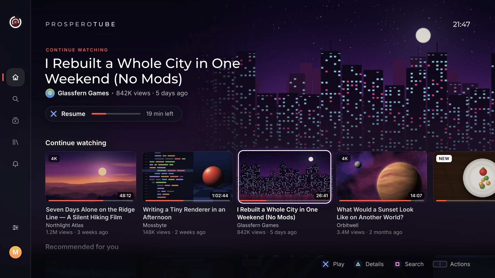
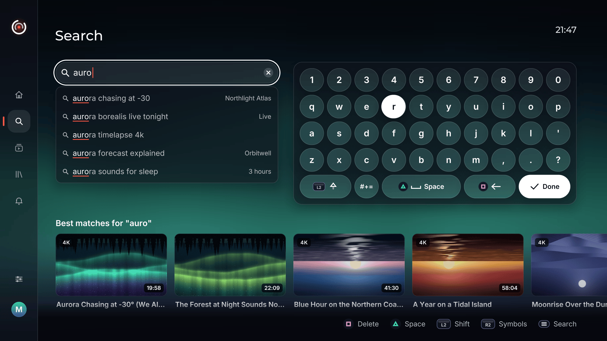
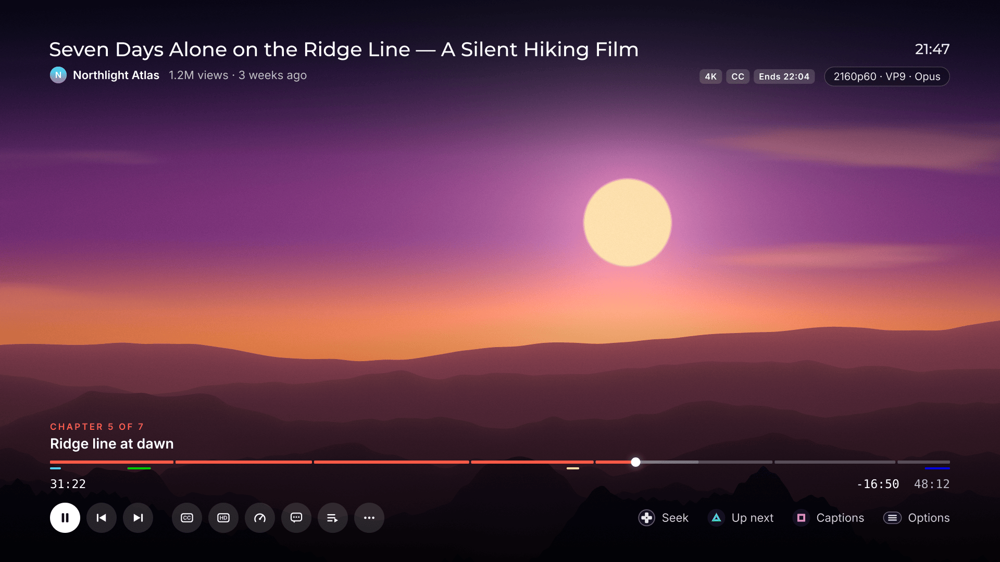

<p align="center">
  
</p>

<h1 align="center">ProsperoTube</h1>

> **In testing: 0.1.0 (content version `01.000.000`) has not been released yet.**
> The self-sufficient build has passed bounded Guest sessions on a PS5, and the
> new Afterglow interface has had its first runs there; accounts, phone casting
> and updates have not been tried on a console yet. No version will be published
> until every Afterglow screen is built and validated on a console
> ([decision](docs/DECISIONS.md)).
> [Status](docs/STATUS.md) records what was tested and where.

<p align="center">
  <strong>A native YouTube client for PlayStation 5 homebrew</strong><br>
  Browse, search and watch YouTube on the console with no computer involved:
  the YouTube service runs inside the app, and video plays straight from
  YouTube's servers on the PS5 decoders.
</p>

<p align="center">
  
  
  
  
  
  <a href="LICENSE"></a>
</p>



The picture shows the Afterglow interface's Home as drawn on a PC by the
interface's test harness, with invented sample videos and channels. It is not
a console capture.

## Highlights

- Self-sufficient on the console: a built-in YouTube service (QuickJS-NG
  running YouTube.js) behind a loopback address, HTTPS through libcurl and
  OpenSSL with a built-in root-certificate list, and no Google API key.
- Playback through YouTube's `VISIONOS` client with direct media links, played
  by a patched EVO Player: FFmpeg demuxing, PS5 hardware decoding for AVC, VP9
  and HEVC, and AV1 in software.
- Two interfaces: the complete Classic browser, and Afterglow, a new interface
  drawn with the UI kit [ps5-homebrew-ui](https://github.com/blackbearreloaded/ps5-homebrew-ui),
  in four looks (Afterglow, Onyx, Daybreak, High contrast).
- Guest browsing with search, Home, Discover, channels, playlists, comments and
  live chat, or YouTube accounts signed in on the console with a device code.
- Phone casting from the YouTube app with a TV code (experimental), with the
  receiver running inside the app.
- SponsorBlock segment skipping with review, and DeArrow titles and thumbnails.
- 21 interface languages besides English, local profiles with history, resume,
  favorites and queue, backups, an update check and an in-place self-update.

ProsperoTube is a native PS5 application, not a port of an Android or desktop
client. At start it gets access to its data folder through Lapy, then starts
its YouTube service: a JavaScript engine thread running a bundled YouTube.js
service and a listener on `127.0.0.1`. The interface asks that service for
pages and videos. A video is played from a small DASH manifest the service
writes; the manifest names YouTube's media servers, and the player reads them
directly.

> [!IMPORTANT]
> ProsperoTube does not run on an unmodified retail console. It is intended
> for consoles you own with an already configured, compatible homebrew loader.
> This repository does not include an exploit, proprietary Sony SDK, system
> module, encryption key, firmware file, or game asset.

## Project foundation

> [!IMPORTANT]
> **Follows the approach of [SmartTube](https://github.com/yuliskov/SmartTube).**
> SmartTube's TV-first browsing and its settings are the behaviour reference:
> [parity](docs/PARITY.md) compares every audited SmartTube surface. No
> SmartTube or MediaServiceCore source is incorporated; the one thing taken
> over is SmartTube's list of blocked live-chat author names
> (`companion/innertube/live_chat.mjs`).

> [!IMPORTANT]
> **Follows the approach of [FreeTube](https://github.com/FreeTubeApp/FreeTube).**
> Like FreeTube, ProsperoTube reads YouTube without an account and without a
> Google API key through YouTube.js. FreeTube is a reference only; none of its
> code or assets is in this repository.

> [!IMPORTANT]
> **Built on [EVO Player](https://github.com/sainsaji/EVO-PLAYER-PS5).**
> The PS5 media player, pinned as the submodule `third_party/evo` (v0.11.0),
> supplies playback, PS5 hardware decoding, audio, the keyboard and packaging.
> The EVO layer, `scripts/prepare_native.py` and its 47 `scripts/*_overlay.py`
> patches, applies ProsperoTube's provider, interface and player changes to a
> generated copy at build time and never edits the submodule.

> [!IMPORTANT]
> **The YouTube service is [YouTube.js](https://github.com/LuanRT/YouTube.js) on [QuickJS-NG](https://github.com/quickjs-ng/quickjs).**
> YouTube.js 18.1.0 (`youtubei.js`) talks to YouTube; QuickJS-NG 0.17.0 runs it
> inside `eboot.bin`, with Pacbrew's libcurl and OpenSSL for HTTPS. The service
> lives in [`standalone/`](standalone/README.md).

> [!IMPORTANT]
> **Afterglow is drawn with [ps5-homebrew-ui](https://github.com/blackbearreloaded/ps5-homebrew-ui).**
> The UI kit is a pinned build input (`scripts/ui_kit.py`), never copied into
> this repository; Afterglow also uses its fonts and its two sound sets.

> [!IMPORTANT]
> **Native foundations from [PS5 Native App Boilerplate](https://github.com/blackbearreloaded/ps5-native-app-boilerplate)
> and the PS5 [video](https://github.com/blackbearreloaded/ps5-hardware-video-decoding-research)
> and [audio](https://github.com/blackbearreloaded/ps5-audio-decoding-research) research.**
> The signed catalog check and loader-started update helper use the boilerplate's kit, and its
> console libcurl support is adapted for the service. The research repositories
> were the decoder references; the inactive microphone path comes from the
> audio research.

> [!IMPORTANT]
> **Uses [SponsorBlock](https://sponsor.ajay.app/) and [DeArrow](https://dearrow.ajay.app/).**
> When turned on, the console asks these community services by Ajay
> Ramachandran and contributors for segments, titles and thumbnails. No
> database snapshot is bundled and nothing is submitted.

The elevation client and its helper build follow
[ProsperoEden](https://github.com/blackbearreloaded/ProsperoEden) (the client
first came from [ProsperoTV](https://github.com/blackbearreloaded/ProsperoTV)), and the entropy
reader and self-exit from [ProsperoLight](https://github.com/blackbearreloaded/ProsperoLight).
Every source, version and licence is listed in
[THIRD_PARTY_NOTICES.md](THIRD_PARTY_NOTICES.md).

| Identity | Value |
| --- | --- |
| Shell title | `ProsperoTube` |
| Title ID | `PPSA99142` |
| Category | Game |
| Version / content version | `0.1.0` / `01.000.000` (not released) |
| Version source | [`scripts/prepare_native.py`](scripts/prepare_native.py), written into `sce_sys/param.json` |
| Writable data | `/data/prosperotube` (Lapy access is required; there is no sandbox fallback) |

## Features

**Browsing**

- Search with suggestions as you type, per-profile search history and
  options (upload date, duration, type, features, order). Search also accepts
  YouTube video and playlist URLs, `video:VIDEO_ID`, `channel:CHANNEL_ID` and
  `playlist:PLAYLIST_ID`.
- Home with its filters, and Discover: topics, Gaming, News, Music, Sports,
  Live, Movies, Trending, Shorts and Kids.
- Channels (Home, Videos, Shorts, Live, Playlists, sort orders, search in the
  channel), playlists and related videos.
- Comments with replies, live chat and chat replay.

**Playback**

- AVC, VP9, HEVC and AV1 in SDR with AAC or Opus sound; adaptive, progressive
  and HLS streams. This is not a claim that every YouTube video or resolution
  plays on a PS5.
- Captions with a second language at the same time, a caption picker during
  playback, caption style, size and position.
- Maximum resolution (144p to 2160p), frame-rate limit, codec and audio
  language per profile; speed from 0.25x to 4x.
- Seeking with three confirmation modes and ten intervals, chapters, a preview
  of the seek target from YouTube's storyboards (off by default), zoom, aspect,
  rotation and mirror, a sleep timer, volume up to 300%, auto volume and audio
  delay.
- Local history with resume positions, favorites, followed channels and an
  ordered play queue per profile; seven end-of-video modes.
- Recovery after stream failures: up to three fresh resolutions per video,
  keeping profile, format, position and captions.

**Accounts**

- Sign-in with a device code on the console, up to eight account profiles next
  to Guest, and removal of an account.
- Subscriptions, subscribed channels, notifications, YouTube history, Watch
  later, playlists and own videos.
- Like, dislike, subscribe and unsubscribe, Watch later, and playlist add,
  remove, create, rename, delete, order and save. Every change is reviewed on a
  confirmation screen and sent once.

**Integrations**

- SponsorBlock: an action per category, minimum segment length, channel
  exclusions, timeline colours, review of a skip and an optional alternative
  server.
- DeArrow titles and thumbnails, each with its own switch.
- Dislike counts from Return YouTube Dislike for a profile that turns **Show
  dislikes** on (off by default).
- Phone casting (experimental): start a video or a queue from the YouTube app,
  play, pause, seek, next, previous, volume, captions and stop.

**Interface and maintenance**

- Two interfaces, Classic and Afterglow (preview), four themes and nine classic
  colour schemes, interface and grid scale, card text and the order of the
  video actions menu, per profile.
- The interface in 21 languages besides English, following the PS5 system
  language or **Interface language**. The player and its notices stay English.
- Backup and restore in `/data/prosperotube/backup`, with an optional automatic
  backup, and subscriptions import from a NewPipe, PocketTube or GrayJay export.
- A signed homebrew.page update check once per launch, release notes and skip
  preferences, with a loader-started helper to replace the app after it closes.
- About with the version, project links as QR codes, credits with their
  licences and the changelog.





Both pictures are Afterglow screens drawn by the same PC test harness with
invented sample data, not console captures.

## Current status

Three bounded sessions on 2026-10-13 ran the self-sufficient build on a PS5,
as Guest and with no computer involved
([hardware acceptance](docs/HARDWARE_ACCEPTANCE.md)). The built-in service
started; Discover and one topic listed their videos through it; a public video
resolved on the console and played from YouTube directly in hardware-decoded
AVC 1080p with AAC sound; a ten-second seek, pause, the caption picker and the
playback options worked; Stop, the saved Guest history and a clean close
followed. These sessions were judged from the app's instrumentation: nobody
assessed sound or motion, and no caption was on screen.

Earlier development builds, which used a companion on a PC, ran on a PS5 for
bounded cases: startup with storage access, search, public AVC playback with
captions, more than two minutes of 1080p60 AVC/AAC with smooth picture and
synchronized sound confirmed by the owner, and, with generated media and a
fixture service, resume, speed changes, the SponsorBlock review, the queue,
two caption languages at once and the chat reader.

On 2026-10-14 the Afterglow interface was tried by hand on a PS5: Home with
real video shelves for a Guest, opening a topic, search with suggestions while
typing, About, and playback of several videos with seeking, through the ranged
manifests described below.

Everything else is tested on a PC only (the offline suite,
`bash scripts/test_all.sh`) and has not run on a console: accounts beyond a
first sign-in, phone casting (no real phone has been linked), the update check
and self-update, the interface languages, AV1 and 4K playback, recovery when a
media link expires, backups and the seek preview. [Status](docs/STATUS.md)
lists each part and its evidence.

Not included yet: playback of videos that need the account (age-restricted,
private, members-only, purchased), voice search, a translated player,
languages that need other fonts or right-to-left layout, auto frame rate, HDR
and background playback.

> [!IMPORTANT]
> ProsperoTube asks YouTube as one client identity, `VISIONOS`, with no
> fallback but HLS. When YouTube changes its service, playback can stop until
> an update of the app arrives. On 2026-10-14 YouTube began refusing requests
> for whole media files; since then the player reads each stream in small byte
> ranges, which for now limits playback to MP4 streams (AVC or AV1 with AAC).

## Roadmap

What is planned, roughly in order. Nothing here has a date.

**Afterglow, as designed**
- [ ] The player as on its boards: the next-video card, Undo after a skipped
      segment, grouped playback options, captions in tabs, and the live chat
      beside the video rather than over it.
      The next-video offer and automatic-skip Undo are implemented and
      host-tested; their console acceptance is pending.
- [ ] Home: an unread count on the notifications bell and a "Live now" shelf.
- [ ] Translations of the Afterglow interface's texts into the 21 languages.
- [ ] The interface's own sound recordings in place of the UI kit's sounds.
- [ ] Afterglow as the default interface, once every screen is validated on a
      console.

**Playback**
- [ ] VP9 and Opus streams again, and with them 4K VP9 and HDR, by reading
      WebM streams in ranges as MP4 is read today.
- [ ] Rewinding live streams, and remembering the position in a live stream.
- [ ] Keep playing while browsing.
- [ ] Automatic frame-rate switching to match the video.

**Validation on a console**
- [ ] Accounts in daily use, phone casting with a real phone, and the update
      check with self-update from a published release.

**Smaller items**
- [ ] Posting comments and live-chat messages beyond the current experimental
      rows; queue reordering in the Library.
- [ ] Voice search without a computer.
- [ ] A web proxy setting.
- [ ] Backup to Google Drive.
- [ ] Video previews on focused cards.

The [parity table](docs/PARITY.md) tracks every SmartTube feature and how far
ProsperoTube has come with it.

## Requirements

On the console: a PS5 that runs homebrew, with its ELF loader listening on TCP
port 9021 (most setups have it; ProsperoTube sends its bundled Lapy helper
through it) or a resident Lapy service, and an internet connection.
ProsperoTube stops at startup when it cannot get access to `/data/prosperotube`.

To build, Linux or WSL. On Ubuntu or Debian:

```bash
sudo apt-get install clang-18 lld-18 llvm-18 cmake ninja-build make git \
  python3 python3-venv pkg-config ccache wget curl unzip zip nasm yasm \
  libssl-dev libfreetype-dev libzstd-dev libbz2-dev liblzma-dev ffmpeg
export PATH=/usr/lib/llvm-18/bin:$PATH
git submodule update --init --recursive
bash scripts/bootstrap_sdk.sh
```

The bootstrap fetches the PS5 Payload SDK and Pacbrew release assets into a
user prefix under `~/.cache/prosperotube`. The first build of the PS5 shader
compiler needs further packages; [Build](docs/BUILD.md) lists them and the
pins. The offline checks also need Node (the workflow uses 24.10.0) and a
Python virtual environment with `companion/requirements.lock`.

## Build

```bash
# Once: the PS5 shader compiler for the display transforms.
bash scripts/build_ps5_shader_compiler.sh

# The application, with the built-in YouTube service.
bash scripts/build_ps5.sh

# The same, plus a .ffpfsc image.
bash scripts/build_ps5.sh --ffpfsc
```

Outputs are written to:

```text
dist/PPSA99142/        complete title folder
dist/PPSA99142.zip     the folder as a ZIP
dist/PPSA99142.ffpfsc  compressed image (with --ffpfsc)
```

The offline checks:

```bash
bash scripts/test_all.sh        # every host check: service, provider, player overlays, interface
bash scripts/test_afterglow.sh  # Afterglow's boards in the four looks
```

## GitHub Actions and releases

The [Build workflow](.github/workflows/build.yml) runs for version tags and
when started by hand; pushes and pull requests build nothing. It:

1. checks out the source with its submodules;
2. installs the Linux toolchain and Node;
3. checks that a tag is `v` + the content version and that release notes exist;
4. restores or builds the PS5 SDK, dav1d, FFmpeg and the shader compiler
   (the first run takes hours; later runs use the Actions cache);
5. runs `bash scripts/test_all.sh` and builds the app;
6. checks the ZIP (one app folder, `eboot.bin`, every entry stored 0777, the
   version) and writes `SHA256SUMS`; and
7. for a tag, publishes a pre-release with `PPSA99142.zip` and `SHA256SUMS`.

The workflow needs no secret and never replaces a ZIP a release already has.

## Update an installed copy

The app checks homebrew.page's signed catalog once per launch. Once a public
release is listed there, **Settings > About** offers **Update to ... now**
and **Restart to finish updating**. The packaged helper requires the console's
payload loader on port 9021; it verifies and stages the release, then replaces
the files after ProsperoTube closes. Wait for its completion notification
before reopening the app. Integration is host-tested; a complete console update
from a published signed release remains pending. [Updates](docs/UPDATES.md)
describes the mechanism and its recovery behavior.

By hand:

1. Download `PPSA99142.zip` from the release and check it with `SHA256SUMS`.
2. Fully close ProsperoTube.
3. Extract the ZIP and upload its complete `PPSA99142` folder to
   `/data/homebrew/`, so that `/data/homebrew/PPSA99142/eboot.bin` exists. Do
   not upload the ZIP itself.
4. Start ProsperoTube.

Settings, profiles and accounts are kept in `/data/prosperotube` and are not
touched by an update.

## Deploy

Nothing in this repository deploys to a console. Copy the complete
`dist/PPSA99142` folder to `/data/homebrew/PPSA99142` with your usual tool,
with ProsperoTube closed; `eboot.bin` alone is not a valid deployment. A copy
installed as an image or built for development runs, but lists newer
versions without updating itself.

[`tools/console`](tools/console/README.md) is the bounded session driver that
produced the hardware records; it is a development tool.

## Watching as Guest or signing in

ProsperoTube opens as **Guest**: search, Home, Discover, channels, playlists,
comments and playback work without an account, and history, favorites and the
queue are kept on the console.

To sign in, open **Discover > Accounts & library > Sign in to YouTube**. The
app shows a code and the address to enter it at, also as a QR code, and checks
by itself until the sign-in is authorized, denied, cancelled or expired. The
account becomes a profile next to Guest.

- **Unverified until a real sign-in.** Sign-in and every account list and
  change were tested on a PC against canned answers. A list or change that
  fails does not affect Guest browsing or playback.
- **Playback stays Guest's.** A signed-in profile resolves videos as Guest
  does and reports watch history to the account, unless **History** is off or
  the video is played incognito.
- **The sign-in is kept as plain text** in
  `/data/prosperotube/accounts/oauth-profiles.json`: the PS5 offers no
  encrypted storage, and the file is not part of backups. **Remove selected
  account** deletes it from the console; to revoke it at Google as well, remove
  "YouTube on TV" under <https://myaccount.google.com/permissions>.

## Casting from a phone

Phone casting is experimental and has not been tried with a real phone.

1. In the player preferences, choose **Link a phone**. ProsperoTube shows a TV
   code.
2. In the YouTube app on the phone, open *Watch on TV > Enter TV code* and type
   it.
3. Start a video or a queue from the phone; play, pause, seek, next, previous,
   volume, captions and stop work from there.

The preferences also choose what happens when the phone disconnects (keep
playing, stop, close the app) and whether phone playback enters the history.
**Reset phone pairing** forgets this console's identity. Details are in
[the remote service](docs/REMOTE_SERVICE.md).

## Choosing the interface and theme

- **YouTube preferences > Interface > Interface** chooses **Classic**, the
  default and complete browser, or **Afterglow (preview)**. Afterglow's
  screens are in the tree and drawn by its PC harness, but it has never run on
  a console; a page it does not have yet says so.
- **Theme**, per profile: Afterglow (the default), Onyx on true black, the
  light Daybreak, or High contrast; the nine earlier colour schemes are under
  **Classic colours**.
- **Player settings > Theme** is EVO's own and shared by every profile: it
  colours the keyboard, dialogs and player settings.
- **YouTube preferences > Interface language** chooses one of the 21
  languages or English instead of the PS5 system language.

## Controls

The icons are the controller's buttons. ![Touchpad][touchpad] is the touchpad button: press the
touchpad down until it clicks. The tables are for the Classic interface;
Afterglow shows its buttons at the foot of every screen, and its full map is in
the [design notes](docs/afterglow/design-notes.md#10-controller-map).

### Browser

| Input | Action |
| --- | --- |
| ![D-pad][dpad] / ![Cross][cross] | Move focus / open or watch |
| ![Square][square] | Search |
| ![Circle][circle] | Back; cancel a pending request |
| ![Triangle][triangle] | Toggle favorite |
| R2 / L2 | Toggle queue / follow the video's channel |
| ![L1][l1] / ![R1][r1] | Previous / next page |
| R3 | Comments, or live chat on a live video |
| ![Touchpad][touchpad] | Video actions; section and pin actions on a folder; playlist edits; ratings for a displayed comment |
| ![Options][options] | Retry the built-in service if it did not start |

In comments, ![Cross][cross] opens replies, L2 / R2 scroll the full text,
![L1][l1] / ![R1][r1] page, R3 switches top and newest and ![Triangle][triangle]
opens the chat replay. In chat, R3 switches top and live, ![Triangle][triangle]
loads more replay messages and ![L1][l1] / ![R1][r1] move the replay by one
minute.

### Player

| Input | Action |
| --- | --- |
| ![Cross][cross] | Pause or resume (four behaviours selectable while the controls are hidden) |
| ![D-pad][dpad] left / right | Seek |
| ![L1][l1] / ![R1][r1] | Previous / next chapter |
| ![D-pad][dpad] up / down | Toggle captions / caption picker |
| R2 | Playback options: quality, audio, speed and the video actions |
| L2 / ![Touchpad][touchpad] halves | Caption timing |
| ![Triangle][triangle] | Video sizing |
| R3 | Jump to the next SponsorBlock highlight |
| ![Square][square] / ![Options][options] | Media information / statistics |
| ![Circle][circle] | Stop (confirmed) |

The D-pad directions can be reassigned under **Player controls, keys and
Shorts**. Live streams have no seekable timeline. Closing ProsperoTube from its
menu releases its resources and parks the application; close it from the PS5
switcher afterward.

[cross]: docs/images/buttons/cross.svg "Cross"
[circle]: docs/images/buttons/circle.svg "Circle"
[square]: docs/images/buttons/square.svg "Square"
[triangle]: docs/images/buttons/triangle.svg "Triangle"
[options]: docs/images/buttons/options.svg "Options"
[l1]: docs/images/buttons/l1.svg "L1"
[r1]: docs/images/buttons/r1.svg "R1"
[dpad]: docs/images/buttons/dpad.svg "D-pad"
[stick]: docs/images/buttons/stick.svg "Analog stick"
[touchpad]: docs/images/buttons/touchpad.svg "Touchpad button"

## Files on the console

When it starts, ProsperoTube asks for filesystem access the way ProsperoEden
does: if `/data` already works (and lists), nothing else is needed; otherwise a
separately loaded resident Lapy service gets the first 1.5 seconds, then the
packaged one-shot helper, which serves `PPSA99142` only, is sent to the
jailbreak's ELF loader on TCP port 9021 (see
[`native/elevation`](native/elevation/README.md)). Everything the app writes is
in one folder that an update or a reinstall does not touch:

| Path | Contents |
| --- | --- |
| `/data/prosperotube/youtube.json` | Settings, profiles, history, favorites, queues and the phone receiver's identity, replaced atomically |
| `/data/prosperotube/accounts/oauth-profiles.json` | Signed-in accounts, as plain text |
| `/data/prosperotube/backup/` | Backups, manual and automatic |
| `/data/prosperotube/import/` | Place a subscriptions export file here to import it |
| `/data/prosperotube/cache/` | The built-in service's small cache; safe to delete |
| `/data/prosperotube/providers/youtube/art/` | Thumbnails kept between launches |
| `/data/prosperotube/update-sequence` | Highest accepted signed catalog sequence |
| `/data/prosperotube/update-preferences` | Notification switch and skipped version |
| `/data/prosperotube/interface-language` | The chosen interface language, for all profiles |

There is no fallback: when Lapy access is refused or the app cannot write and
read back a file in `/data/prosperotube`, startup stops before any service
starts, rather than keeping state somewhere temporary. To start over, delete
`/data/prosperotube` while the app is closed. Whoever can read that folder can
use the signed-in accounts on YouTube.

The built-in service listens on `127.0.0.1` only, on a port chosen at each
start, behind a random token kept in memory, and writes no log. The update
check sends a generic `User-Agent` and no identifier. More in
[the protocol and security notes](docs/PROTOCOL.md).

## Source layout

```text
native/tube_provider.c        the YouTube provider: pages, playback, profiles, state
native/youtube.rml, .rcss     the Classic browser (RmlUi)
native/afterglow/             the Afterglow interface: frame, screens, player controls, sound
native/text/                  the text engine behind Afterglow (HarfBuzz, FriBidi, FreeType)
native/tube_update*.c         update check and self-update
native/elevation/             the Lapy client and its packaged helper
native/i18n/                  the interface catalogs, 21 languages
native/branding/              home-screen icon, 4K backgrounds, selection music
native/licenses/              licence texts shipped with the app
standalone/                   the built-in service: QuickJS-NG bindings, HTTPS client, JS service
companion/                    the PC companion and YouTube.js library modules (development)
scripts/prepare_native.py     the EVO layer: applies scripts/*_overlay.py to a copy of EVO
scripts/build_ps5.sh          the PS5 package build
scripts/test_*.sh, *.py       offline checks
tests/                        native, Python and Afterglow harness tests
tools/console/                bounded console session driver (development)
third_party/evo/              EVO Player, pinned submodule
docs/                         status, validation, build, design and decisions
```

## Versioning

The content version (`contentVersion="01.000.000"`) and the version shown to
people (`0.1.0`) are set in [`scripts/prepare_native.py`](scripts/prepare_native.py),
which writes them into `sce_sys/param.json`. `python3 scripts/release_version.py`
prints the title, content version and version; `--tag` prints the tag, which is
`v` + the content version.

```bash
# After raising the version and passing the offline checks:
git tag v01.000.000
git push origin v01.000.000
```

Keep `PPSA99142`, `conceptId` and `contentId` stable for updates to this
title. A new version shown to people also needs its `CHANGELOG.md` section and
`python3 scripts/generate_about.py`; [Build](docs/BUILD.md#releasing) has the
steps.

## Documentation

| Document | Purpose |
| --- | --- |
| [Changelog](CHANGELOG.md) | User-visible changes in each version |
| [Status](docs/STATUS.md) | What is implemented, what was tested and where |
| [Handoff notes](docs/HANDOFF.md) | Where the work stands, what comes next, and how to build, test and install |
| [Hardware acceptance](docs/HARDWARE_ACCEPTANCE.md) | Every console session and its result |
| [Validation](docs/VALIDATION.md) | Dated host and package validation record |
| [Build](docs/BUILD.md) | Dependencies, pins, the PS5 build, checks and releasing |
| [Updates](docs/UPDATES.md) | Update check and self-update |
| [Localization](docs/LOCALIZATION.md) | Interface languages and what stays English |
| [Decisions](docs/DECISIONS.md) | Built-in service, accounts, phone receiver, Afterglow |
| [Parity](docs/PARITY.md) | Comparison with every audited SmartTube surface |
| [Protocol](docs/PROTOCOL.md) | Service API and security notes |
| [Library service](docs/LIBRARY_SERVICE.md) | Account and library contracts |
| [Remote service](docs/REMOTE_SERVICE.md) | The phone receiver |
| [Voice search](docs/VOICE_SEARCH.md) | Why voice search is not in the release |
| [Reference candidates](docs/REFERENCE_CANDIDATES.md) | Playback and service references |
| [Afterglow design notes](docs/afterglow/design-notes.md) | The interface proposal and controller map |
| [Afterglow architecture](docs/afterglow/ARCHITECTURE.md) | How Afterglow is built and tested |
| [Built-in service](standalone/README.md) | The service as a host program and on the console |
| [Notices](THIRD_PARTY_NOTICES.md) | Dependency, asset and licence attribution |

### Elevation credits

Filesystem elevation uses [PS5-Lapy-JB-Daemon](https://github.com/ArkSama/PS5-Lapy-JB-Daemon),
created by ArkSama, with the cooperative owned-root helper from
[mpereiraesaa's PS5-Lapy-JB-Daemon](https://github.com/mpereiraesaa/PS5-Lapy-JB-Daemon)
and contributors. The build pins commit `57fcc19` of the
[BlackBearReloaded fork](https://github.com/blackbearreloaded/PS5-Lapy-JB-Daemon), which
carries the donor-release and firmware 13.60 fixes of
[PR #48](https://github.com/mpereiraesaa/PS5-Lapy-JB-Daemon/pull/48) and
[PR #49](https://github.com/mpereiraesaa/PS5-Lapy-JB-Daemon/pull/49) and the guarded
target-lifetime changes of [PR #50](https://github.com/mpereiraesaa/PS5-Lapy-JB-Daemon/pull/50),
runs upstream's own exact-title helper build for `PPSA99142` without changing it, verifies
the generated manifest and ships the helper (MIT; its protocol header is LGPL-2.1-or-later)
with its licence, as [ProsperoEden](https://github.com/blackbearreloaded/ProsperoEden) does.

<!-- bbr-footer:start -->
<!-- Generated by ps5-homebrew-dev-protocol/scripts/readme-footer. Edit the template there, not here. -->

## Credits

Built with the [PS5 Payload SDK](https://github.com/ps5-payload-dev/sdk) by John Törnblom (ps5-payload-dev).
Third-party components, authors and licenses are listed in
[THIRD_PARTY_NOTICES.md](THIRD_PARTY_NOTICES.md).

## License

Copyright © 2026 BlackBearReloaded. Licensed under GPL-3.0-or-later; see [LICENSE](LICENSE). Third-party components keep their own licenses. Binary releases are built from the tagged source in this repository.

## Disclaimer

- **No affiliation.** This is an independent homebrew project. It is not
  affiliated with, endorsed by, or sponsored by Sony Interactive Entertainment.
  "PlayStation", "PS5" and related marks are trademarks of Sony Interactive
  Entertainment Inc. This project is not affiliated with or endorsed by YouTube, Google or the EVO Player project. YouTube is a trademark of Google LLC.
- **No proprietary material.** No Sony SDK, firmware, encryption keys or
  decrypted system modules are included.
- **No warranty.** This project is provided "as is", without warranty of any
  kind, to the extent permitted by law. See sections 15 and 16 of the GPL.
- **Use at your own risk.** Running homebrew requires a modified console, which
  may void its warranty, breach the platform's terms of service, or cause data
  loss.
- **Legal use only.** Use it only with hardware, accounts and content you own.
  This project does not support or enable piracy.

## AI assistance

This project was developed with AI assistance from OpenAI and/or Anthropic tools.
<!-- bbr-footer:end -->
